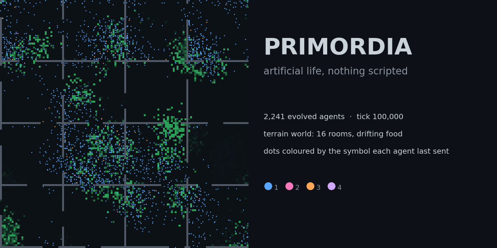
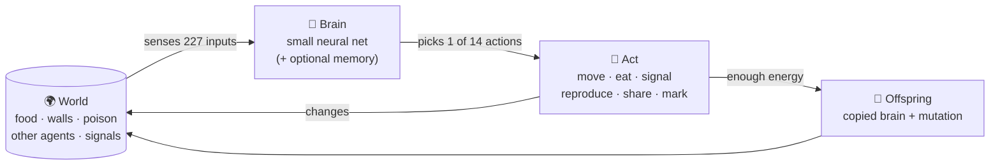
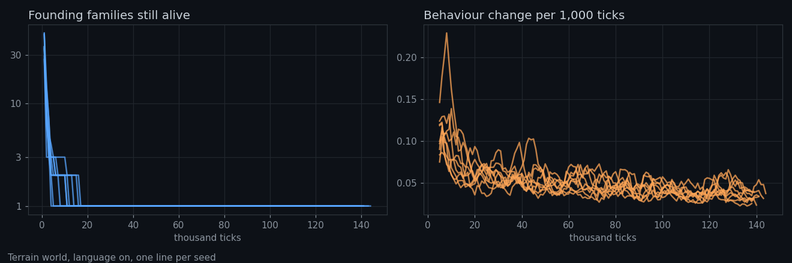

<p align="center">
  
</p>

<p align="center">
  <b>Tiny neural-network creatures, one shared world, and evolution doing all the work.</b><br>
  No behaviour is scripted. Everything they do, they had to discover.
</p>

<p align="center">
  
  
  
  
  
</p>

---

## 🧬 The idea

Drop a few hundred random brains into a world with food, walls and each other. Let the ones that eat survive and reproduce with small mutations. Repeat for a million ticks.

**What does a world need before its creatures evolve something genuinely new** (cooperation, memory, a language) instead of the obvious "find food, eat, stay near others"?

Primordia is an experiment-by-experiment search for that answer, with every claim held to a strict test.

## ⚙️ How a creature works



Each tick, every agent senses its surroundings, its brain picks an action, and the world updates. Energy is the only currency: run out and you die, collect enough and you split into a mutated child.

## 🔬 How we know what's real

Early on, single runs produced exciting "discoveries" that turned out to be luck. Every result now has to pass two checks:

1. **Ablation across 10 seeds:** two worlds that differ in exactly one feature, each run on many random seeds.
2. **Lesion test:** take the evolved creatures, give them equal energy and age, then switch the feature off in their heads. If performance doesn't drop, they weren't using it.

## 📊 What we've found

| | Feature | Verdict |
|:-:|---|---|
| ✅ | **Social sensing** | Real and used. Switching it off cuts eating on **10/10** seeds. |
| ✅ | **Poison avoidance** | Real. Creatures learn to steer around hazards. |
| 🟡 | **Two-symbol language** | First hint, in walled terrain: language worlds survived **5/5** seeds vs **2/5** without. Signals still carry little meaning. *Being tested on more seeds.* |
| ❌ | Communication (4 symbols) | Agents can signal, but nobody listens: removing signals changes nothing. |
| ❌ | Working memory | Doesn't help, even when it starts switched off and has to earn its place. |
| ❌ | Shared food (needs two eaters) | Looks like teamwork, but it's crowding: hiding the food changes nothing. |
| ❌ | Seasons | No smarter brains. An earlier "win" was a timing artefact. |

<p align="center">
  
</p>

**Every world ends up descended from a single founder out of 300, and behaviour settles down within ~50,000 ticks.** Evolution finds one good way to live and stops exploring. That's the problem the next stage of the project attacks.

📖 The full lab notebook, with every table, correction and dead end, is in [`FINDINGS.md`](FINDINGS.md).

## 🗺️ Roadmap

- [x] **Fast engine:** NumPy + Numba rewrite, ~110–180× faster, plus a PyTorch/GPU version
- [x] **Sparse world:** drifting, vanishing food clusters and walled terrain
- [ ] **Long runs:** 1,000,000 ticks with a novelty meter and family trees *(running now)*
- [ ] **Worlds that push for novelty**
  - [ ] ⚔️ An arms race: predators that evolve too
  - [ ] 🍄 Several ways to live: food types that need different skills
  - [ ] 🏗️ Creatures that change the world: storing food, building, leaving lasting marks
- [ ] Bigger brains, only where they're needed
- [ ] Large many-seed sweeps
- [ ] 🌐 3D

## 🚀 Try it

```bash
pip install numpy numba            # add torch for the GPU engine

# evolve a walled world where agents can talk, for 100,000 ticks
python fast/run_fast.py fast/runs/demo --mode terrain_language --arm on --seed 1 --ticks 100000

# run a full experiment: language on vs off, 5 seeds, 8 at a time (resumable)
python fast/replicate_modes.py --modes terrain_language --seeds 1 2 3 4 5 --jobs 8
```

<details>
<summary><b>Lesion-test a population you evolved</b></summary>

```python
import sys; sys.path.insert(0, "fast")
import evaluate_fast as v

ckpt = "fast/runs/demo/checkpoint_100000.pkl"
with_lang    = v.profile(ckpt, reset_state=True)
without_lang = v.profile(ckpt, reset_state=True, override={"language": False})
print(with_lang["energy"] - without_lang["energy"])   # > 0 means they use it
```
</details>

<details>
<summary><b>All experiment modes</b></summary>

Defined in [`fast/modes.py`](fast/modes.py):

| Mode | What differs between the two arms |
|---|---|
| `stage1` | Social sensing |
| `stage2` | Communication |
| `stage3` | Seasons |
| `stage5` | Poison hazards |
| `stage13` | Shared food |
| `sparse2_memory` / `sparse2_memory0` | Working memory (inherited / starting at zero) |
| `sparse2_comm` | Communication in a sparse world |
| `sparse2_language` | Two-symbol language in a sparse world |
| `sparse2_cofood` | Shared food in a sparse world |
| `terrain_language` | Two-symbol language in a walled world |
</details>

## 🗂️ Repository

```
fast/      the current engine (engine.py, kernels.py, engine_torch.py), run + analysis tools
stages/    the original engine, one folder per experiment (01 social sensing … 13 shared food)
           + the 300 evolved founders later experiments start from
lab/       evaluation and replication tools for the original engine
docs/      images and older notes
```

Run outputs (logs and saved worlds, tens of GB) are kept locally, not in the repo.

## 📄 License

MIT. See [`LICENSE`](LICENSE).
