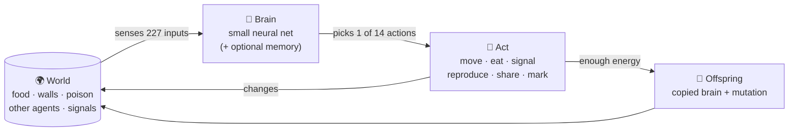

<p align="center">
  
</p>

<p align="center">
  <b>Tiny neural-network creatures, one shared world, and evolution doing all the work.</b><br>
  No behaviour is scripted. Everything they do, they had to discover.
</p>

<p align="center">
  
  
  
  
  
</p>

---

## 🧬 The idea

Drop a few hundred random brains into a world with food, walls and each other. Let the ones that eat survive and reproduce with small mutations. Repeat for a million ticks.

**What does a world need before its creatures evolve something genuinely new** (cooperation, memory, a language) instead of the obvious "find food, eat, stay near others"?

Primordia is an experiment-by-experiment search for that answer, with every claim held to a strict test.

## ⚙️ How a creature works



Each tick, every agent senses its surroundings, its brain picks an action, and the world updates. Energy is the only currency: run out and you die, collect enough and you split into a mutated child.

## 🔬 How we know what's real

Early on, single runs produced exciting "discoveries" that turned out to be luck. Every result now has to pass two checks:

1. **Ablation across 10 seeds:** two worlds that differ in exactly one feature, each run on many random seeds.
2. **Lesion test:** take the evolved creatures, give them equal energy and age, then switch the feature off in their heads. If performance doesn't drop, they weren't using it.

## 📊 What we've found

| | Feature | Verdict |
|:-:|---|---|
| ✅ | **Social sensing** | Real and used. Switching it off cuts eating on **10/10** seeds. |
| ✅ | **Poison avoidance** | Real. Creatures learn to steer around hazards. |
| ✅ | **Several ways to live** | With buried food reachable only by digging and a heritable digestion trade-off, digging evolved in **7/7** surviving worlds, and in **3/7** the population split into two coexisting groups (surface eaters and diggers) that **lasted a million ticks** (~53/47, swinging back whenever one group grew too common), with matching behaviour and each dependent on its own food in lesion tests. Control: 0/10. |
| 🟡 | **Stepping stones** (replicating Lenski et al. 2003) | A 4-dig sequence evolved in **10/10** worlds when each step paid a little, vs **6/10** when only the full sequence paid (p ≈ 0.04), and sooner. Same direction as Avida, weaker, because repeating one action is easier than combining different ones. |
| ✅ | **Evolving predators** | A one-sided arms race. Predators keep getting better at hunting for a million ticks (**+46%**, 9/10 seeds; frozen predators: no gain). Prey evolve a real defence, reacting to predators they can sense (blinding them raises kills on 9/10 seeds), but still lose ground. |
| ❌ | Shelters (placed) | Prey never learned to use them, and they made collapse **more** likely: 6/10 shelter worlds died out vs 0/10 without (p ≈ 0.005). A refuge only helps if evolution discovers it. |
| 🟡 | Shelters (built by prey) | All 10 worlds survived (placed: 4/10). Building persisted in 7/10, and prey stand in shelters 1.2–2.3× more than chance. One world found a loophole (energy-creating gifts) and exploded. |
| ❌ | Food storage (public) | Tragedy of the commons: storing is selected against (0.10% of actions vs 0.97% when it does nothing, 10/10); taking is selected for. |
| ❌ | Two-symbol language | Not used, even in walled terrain. A 5-seed "hint" vanished at 10 seeds and at 1,000,000 ticks. |
| ❌ | Communication (4 symbols) | Agents can signal, but nobody listens: removing signals changes nothing. |
| ❌ | Working memory | Doesn't help, even when it starts switched off and has to earn its place. |
| ❌ | Shared food (needs two eaters) | Looks like teamwork, but it's crowding: hiding the food changes nothing. |
| ❌ | Seasons | No smarter brains. An earlier "win" was a timing artefact. |
| ✅ | **Worlds that keep evolution inventing** (ASAL's search, scored with the published MODES measure) | On 10 fresh seeds, the two worlds it found produce **1.75-2.8x as many lasting new strategies** as the plain world, more per creature (+35% and +54%), more diverse, all 10/10 surviving (p <= 0.0014). Common ingredients: a rich second food source, gentle predators, a few shelters. |
| ✅ | **Spatial structure drives lasting novelty** (after Rainey & Travisano 1998) | Shaking the best world (food reshuffled every tick) **nearly halves lasting novelty per creature** (15.3 vs 27.3, p = 0.0001) and lowers diversity, even though more creatures live there. |
| 🟡 | **Separate habitats / harsher digestion trade-off** | Separating the habitats does nothing (p = 0.77). A harsher trade-off makes each creature more inventive (+25% lasting novelty per creature, p = 0.0002) but the world holds fewer creatures and fewer strategies in total. |
| ❌ | **Remains** (food made only by other creatures' deaths; Soros & Stanley's condition 2) | No scavengers evolved and lasting novelty was the same as with the same food at random places (p = 0.51). But both scored far below worlds with soil-grown buried food: a steady second food source matters. |
| ❌ | **Evolvable actions** (creatures evolve their own action chains) | Chains get used (4% of actions) but lasting novelty is no higher (p = 0.36). In 2/10 worlds a persistent strategy was built from chains (complexity 5 and 9, the first time the ceiling of 3 was broken), but that's rare. |
| ❌ | **Open brains** (no fixed brain size; Soros & Stanley's condition 4) | Brains don't grow when allowed to (24.8 vs 23.9 units after 100k ticks), and lasting novelty is no higher (MODES, 10 vs 10 seeds, p = 0.29). Extra neurons don't pay when senses and actions are fixed. |
| ❌ | **Image-model search for open-ended worlds** (ASAL, applied to evolving creatures) | Its top-rated world died out in **9/10** fresh runs and produced about a fifth of the lasting new strategies of the plain world (MODES, p = 0.0001). Picture novelty rewards boom-and-bust, not lasting evolution. Along the way it found three loopholes (near-dead, shrinking and crashing worlds all "look new"). |

<p align="center">
  
</p>

**A million ticks makes creatures leaner, not new.** Every world collapses to a single founding family out of 300 within ~35,000 ticks. Over the next 965,000 ticks populations grow by ~30% on the same food as evolution trims wasted actions (signalling halves, idling drops), but no new behaviour ever appears. Evolution finds one good way to live and stops exploring. That's the problem the next stage of the project attacks.

📖 The full lab notebook, with every table, correction and dead end, is in [`FINDINGS.md`](FINDINGS.md).

## 🗺️ Roadmap

- [x] **Fast engine:** NumPy + Numba rewrite, ~110–180× faster, plus a PyTorch/GPU version
- [x] **Sparse world:** drifting, vanishing food clusters and walled terrain
- [x] **Long runs:** 1,000,000 ticks with a novelty meter and family trees
- [ ] **Worlds that push for novelty**
  - [x] ⚔️ An arms race: predators that evolve too *(rounds 1 and 2b done: predators keep improving, prey don't keep up; placed shelters backfire)*
  - [x] 🍄 Several ways to live: food types that need different skills *(two-niche split on 3/7 worlds, stable to 1M ticks)*
  - [ ] 🏗️ Creatures that change the world: storing food, building, leaving lasting marks
- [x] 📏 Measure open-endedness the published way: MODES (Dolson et al. 2019) and ASAL (Kumar et al. 2024) on Primordia
- [x] 🧠 Open brains: no fixed brain size (Soros & Stanley's condition 4): **no effect**; brains don't grow when allowed to
- [x] 🧩 Evolvable actions: creatures evolve their own action chains: **no effect on lasting novelty**; first complexity above the ceiling, in 2/10 worlds
- [x] 🔎 Search for the kind of world that keeps producing lasting novelty (ASAL's search, scored with MODES): **found and confirmed**
- [x] 🌱 Remains: food made by other creatures' deaths (Soros & Stanley's condition 2): **no effect**; no scavengers evolved
- [ ] 🏞️ Separate habitats, shaken, switching and 4x-larger worlds *(queued)*
- [ ] Large many-seed sweeps
- [ ] 🌐 3D

## 🚀 Try it

```bash
pip install numpy numba            # add torch for the GPU engine

# evolve a walled world where agents can talk, for 100,000 ticks
python fast/run_fast.py fast/runs/demo --mode terrain_language --arm on --seed 1 --ticks 100000

# run a full experiment: language on vs off, 5 seeds, 8 at a time (resumable)
python fast/replicate_modes.py --modes terrain_language --seeds 1 2 3 4 5 --jobs 8
```

<details>
<summary><b>Lesion-test a population you evolved</b></summary>

```python
import sys; sys.path.insert(0, "fast")
import evaluate_fast as v

ckpt = "fast/runs/demo/checkpoint_100000.pkl"
with_lang    = v.profile(ckpt, reset_state=True)
without_lang = v.profile(ckpt, reset_state=True, override={"language": False})
print(with_lang["energy"] - without_lang["energy"])   # > 0 means they use it
```
</details>

<details>
<summary><b>All experiment modes</b></summary>

Defined in [`fast/modes.py`](fast/modes.py):

| Mode | What differs between the two arms |
|---|---|
| `stage1` | Social sensing |
| `stage2` | Communication |
| `stage3` | Seasons |
| `stage5` | Poison hazards |
| `stage13` | Shared food |
| `sparse2_memory` / `sparse2_memory0` | Working memory (inherited / starting at zero) |
| `sparse2_comm` | Communication in a sparse world |
| `sparse2_language` | Two-symbol language in a sparse world |
| `sparse2_cofood` | Shared food in a sparse world |
| `terrain_language` | Two-symbol language in a walled world |
| `arms_race` | Predators that evolve vs predators that copy exactly |
| `arms2b_shelter` | Evolving predators, with vs without shelters (round 2, fixed newcomer rule) |
| `ways` | Buried food + digestion trade-off vs surface food only |
</details>

## 🗂️ Repository

```
fast/      the current engine (engine.py, kernels.py, engine_torch.py), run + analysis tools
stages/    the original engine, one folder per experiment (01 social sensing … 13 shared food)
           + the 300 evolved founders later experiments start from
lab/       evaluation and replication tools for the original engine
docs/      images and older notes
```

Run outputs (logs and saved worlds, tens of GB) are kept locally, not in the repo.

## 📄 License

MIT. See [`LICENSE`](LICENSE).
